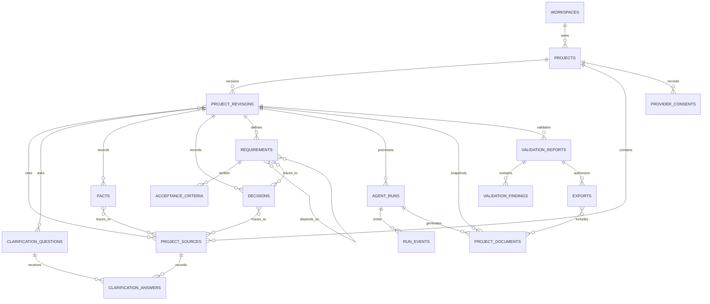

# Persistence ERD and Migration Plan

**Status:** Implemented with explicit Alembic migrations; includes short-lived web session persistence.  
**Scope:** Initial local, single-user PostgreSQL persistence. This is a database design contract, not evidence that persistence has been implemented.

## Design goals

- Preserve projects across API restarts without changing the local-only, no-account release boundary.
- Keep each project mutation as an immutable, optimistic-concurrency-controlled revision.
- Preserve provenance without copying raw user content into logs, run events, or every snapshot.
- Make project deletion remove all project-linked content in one database transaction.
- Keep generated documents immutable and bind validation/export records to exact content hashes.
- Keep model/provider credentials out of the database and application logs.
- Use explicit Alembic migrations; application startup must never create or migrate tables.

## Ownership and workspace boundary

Create one local `workspace` row as the data-ownership boundary. There is no account, password, or remote authentication in the initial release. The application resolves the local workspace ID at startup and supplies it to every repository operation. Project-scoped rows carry `workspace_id`; composite foreign keys prevent references across workspaces. Repositories always filter by both workspace and resource ID. This is defense against cross-project mistakes, not a substitute for authentication before any public deployment.

No sample projects or other user-content seed data are created. A local workspace row is infrastructure metadata, not a demo user.

## Entity relationship overview

`audit_events` are intentionally not foreign-key children of projects: a content-minimal deletion event may remain after the project and all its content are physically deleted. `agent_runs` records the run/thread mapping; LangGraph checkpoint tables are deferred to Phase 5 and will live in a dedicated PostgreSQL schema.

## Table responsibilities and integrity rules

| Table | Responsibility and important fields |
|---|---|
| `workspaces` | Local ownership scope: UUID, fixed `local` mode, created timestamp. Enforce at most one local workspace. |
| `web_sessions` | Short-lived legacy HTML workflow continuity: SHA-256 hash of the opaque cookie ID, CSRF token, bounded JSON state, and expiry timestamp. No raw session ID or ZIP bytes are stored. Sessions expire after 30 minutes and a background sweep removes expired rows within about one minute; the JSON state has a 16 MiB encoded-size limit. This table is transport/session state, not canonical project history. |
| `projects` | Current summary and lifecycle: workspace, UUID, name, slug, active/archived status, current revision number, created/updated timestamps. Unique slug within workspace. Do not keep a `deleted_at` soft-delete row. |
| `project_revisions` | Immutable revision number, profile, language, structured intake snapshot (excluding raw source text), schema/template versions, timestamp. Unique `(workspace_id, project_id, revision_number)`. |
| `project_sources` | Sensitive user-provided idea, answer, or edit text, source kind, optional safe label, created timestamp. Content is project-scoped and is never copied into logs/events. |
| `project_revision_sources` | Many-to-many links from an immutable revision to the exact sources used, with a bounded source role. |
| `clarification_questions` | Revision-scoped question, impact, blocking flag, priority, and status. |
| `clarification_answers` | Append-only answer/unknown/defer state linked to a question and source record; only answer text is kept in `project_sources`. |
| `facts` | Revision-scoped confirmed fact, assumption, constraint, or exclusion; statement text, classification, source status, and safe confidence metadata. |
| `fact_sources` | Provenance links from facts to one or more project sources. |
| `decisions` | Revision-scoped proposal and rationale with proposed/accepted/rejected/undecided state and decision timestamp. Accepted proposals are not treated as facts without this explicit record. |
| `decision_sources` | Provenance links from decisions to project sources. |
| `requirements` | Stable, revision-scoped requirement ID, text, priority, status, and origin metadata. |
| `acceptance_criteria` | Ordered, testable criteria linked to one requirement. |
| `requirement_dependencies` | Directed requirement dependency edges; reject self-edges and cycles in the application service. |
| `requirement_sources` | Provenance links from requirements to user-provided sources. |
| `requirement_decision_sources` | Provenance links from requirements to decisions, with a real same-project foreign key. |
| `provider_consents` | Project/revision-scoped provider ID, fixed destination, disclosure version, and granted timestamp. No consent body or credential is stored. |
| `agent_runs` | Project/revision, status, attempt counters, idempotency key and request hash, safe error code, prompt/model/template versions, optional graph thread ID, and lifecycle timestamps. No raw idea or model prompt/response is stored here. |
| `run_events` | Append-only, monotonically sequenced progress and transition metadata; payload is schema-bounded and content-minimal. Unique `(run_id, sequence)`. |
| `project_documents` | Immutable document revision, path, document kind/format, content, SHA-256, source project revision, optional run ID, created timestamp. Unique document revision per project/path. |
| `validation_reports` | Immutable validation result bound to one project revision and the exact document revisions/hashes checked, with validator version and timestamp. |
| `validation_findings` | Rule code, severity, safe detail, optional document/requirement reference, and resolution state; database constraints keep its report and optional references within the same project revision. Do not echo user input. |
| `exports` | Export metadata bound to one successful validation report: manifest, checksum, selected document set, and creation time. Store no long-lived ZIP bytes; reconstruct only from the immutable validated documents. |
| `export_documents` | Join table fixing the exact immutable document revisions included in an export; database constraints keep each document in the export's project revision. |
| `audit_events` | Append-only action code, actor (`local_user` or `system`), subject type/opaque ID, timestamp, and an allowlisted metadata object. No idea text, answer text, documents, prompts, provider headers, or secrets. |

Use UUID primary keys, `timestamptz` in UTC, PostgreSQL `JSONB` only for versioned structured snapshots/manifests, bounded `text`/`varchar` fields where contracts specify maxima, and database checks for enum-like values. Add composite unique and foreign-key constraints that include `workspace_id` wherever a project-owned row references another project-owned row. Do not rely on ORM validation alone.

The legacy HTML workflow may operate without PostgreSQL for backward-compatible local demonstrations, in which case its short-lived session remains process-local. When PostgreSQL is configured, HTML workflow state is persisted in `web_sessions` so it survives restarts and multiple workers. The session cookie remains opaque and `HttpOnly`; only its SHA-256 hash is stored. Export ZIP bytes are reconstructed on download from validated package files rather than persisted in the session.

## Revision and transaction behavior

1. A project starts at revision 1. Its revision snapshot, source rows, provenance links, and project pointer are created in one transaction.
2. Before a state-changing operation, use a caller-owned database transaction, lock the workspace-scoped project row, compare the caller's expected revision with `current_revision`, and return `409 revision_conflict` without writes when stale. Repository methods never commit or roll back the caller's transaction.
3. On success, append the new revision and related source/decision/question changes, then advance `current_revision` in the same transaction. Earlier revisions remain immutable.
4. Create a run with a unique project-scoped idempotency key (1-128 characters) and lowercase SHA-256 canonical request hash. Hash canonical JSON with sorted object keys, compact separators, UTF-8, and non-finite numbers rejected; bound the encoded request to 1 MB and never persist its body in the run row. A repeated key/hash returns the original run; a repeated key with a different hash returns `409 idempotency_conflict`.
5. Commit a state transition and its ordered `run_events` record together. Never expose a completed run unless the required immutable documents and successful validation/export references exist.
6. A validation report names exact document IDs and hashes. An export is rejected if its report is not successful, a document hash has changed, or the project revision is no longer the reviewed revision.
7. Repository methods receive the local workspace ID explicitly; project-scoped lookups include workspace and project/resource identifiers in the same query.

## Deletion and retention

Project deletion is a **hard delete**, not soft deletion. The API first cancels or safely stops active project runs; one transaction then deletes the project row and cascades through revisions, sources, questions/answers, facts/decisions, requirements, runs/events, documents, validation records, consents, and exports. A content-minimal audit event may remain without a foreign key to deleted project content. No project text is copied to the audit event.

The Phase 5 checkpoint adapter must remove every checkpoint/thread associated with the project's runs as part of the deletion workflow; an orphaned checkpoint is not acceptable. Do not claim deletion succeeded until checkpoint cleanup and relational deletion both succeed. Normal PostgreSQL deletion is logical database deletion, not a guarantee of forensic erasure from the host's storage media.

Raw source text is retained only while its project exists. Do not add analytics, general request-body logging, provider prompt logging, or automatic database backups for the local release. The local user is responsible for device/disk protection; PostgreSQL volume files are not separately encrypted by Context OS.

## Migration and rollback plan

- Add SQLAlchemy 2.x asynchronous models/repositories and Alembic; use the plan-selected async PostgreSQL driver.
- Keep migration configuration in `alembic.ini`/`alembic/`; never call `metadata.create_all()` or run migrations implicitly at application startup.
- Apply migrations explicitly with `alembic upgrade head`. Compose must report a clear unhealthy/startup state if the required database or schema is unavailable; do not silently fall back to memory.
- Keep migrations small, forward-only for content-bearing changes unless a lossless downgrade is demonstrably possible. Review generated SQL and test both upgrade-from-empty and supported prior-version upgrade against real PostgreSQL.
- Create one reviewed baseline migration for the empty database containing the approved schema. Future content-bearing changes are small forward migrations; keep checkpoint schema changes isolated to Phase 5.
- This repository has no durable PostgreSQL data to migrate from the MVP: process-memory sessions are ephemeral and intentionally are not copied into the database.
- Before a destructive schema migration, stop and obtain explicit owner approval. The local release makes no backup/restore guarantee; document that a destructive rollback may lose local data.
- Add the LangGraph checkpoint schema and its cleanup migration only in Phase 5, with a tested project-deletion path.

## Indexes and database checks

- Unique `(workspace_id, slug)` and `(workspace_id, project_id, revision_number)`.
- Project list index on `(workspace_id, updated_at DESC, project_id)`.
- Project child foreign keys and lookup indexes beginning with `(workspace_id, project_id)`.
- Unique `(workspace_id, project_id, idempotency_key)` for runs; database checks constrain the key and canonical SHA-256 hash formats to distinguish idempotent replay from conflict.
- Unique `(run_id, sequence)` for events; index `(workspace_id, project_id, created_at)` for run history.
- Unique `(workspace_id, project_id, path, document_revision)` for documents; index report/export references.
- Checks for allowed statuses, profile/language bounds, positive revision/sequence values, valid SHA-256 lengths, and non-self requirement edges.

## Decisions requiring approval

The recommended defaults are: one local workspace with no account system; immutable revisions; normalized source/provenance; hard deletion; no raw content in operational events; no persistent ZIP bytes; and explicit migrations. These choices implement the Phase 0 retention/ownership contracts and must be approved before adding schema tables.

## Not included in this design

The standalone frontend/API contract, database-backed sessions, multi-user authentication, public hosting, backups, distributed workers, LangGraph checkpoint tables, and provider prompt storage are not implemented or authorized by this ERD.
